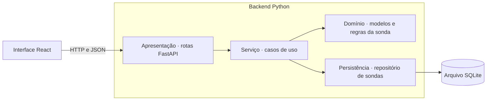

# Sondas em Marte — Projeto de software

## 1. Requisitos

### 1.1 Domínio e regras de negócio

- **RN01** – A sonda inicia em `(0, 0)` com a direção informada.
- **RN02** – As direções válidas são `NORTH`, `EAST`, `SOUTH` e `WEST`.
- **RN03** – Os comandos são executados na ordem enviada. `L` gira 90° no sentido anti-horário e `R` gira 90° no sentido horário, ambos sem deslocamento. `M` avança uma posição na direção atual.
- **RN04** – Cada sonda tem sua própria malha, de `(0, 0)` a `(max_x, max_y)`, com limites inclusivos definidos no lançamento. Cada passo respeita os limites da sonda que recebeu o comando.
- **RN05** – Uma sequência com caractere inválido ou movimento fora da malha é rejeitada por inteiro. A posição e a direção anteriores ao envio são preservadas.
- **RN06** – Sondas são independentes e podem ocupar a mesma posição. Mover uma sonda altera apenas o estado dela.

### 1.2 Requisitos funcionais

**API**

- **RF01** – Lançar sonda. Cada chamada recebe `x` e `y` como limites da nova sonda e `direction` como direção inicial. Retorna um `id` único, posição e direção.
- **RF02** – Mover sonda. Recebe o `id` e a sequência de comandos. Retorna o mesmo `id`, a posição final e a direção final.
- **RF03** – Listar sondas. Retorna uma página de `probes` com `id`, posição e direção atuais.
- **RF04** – Retornar erros padronizados para sonda inexistente, entrada inválida e sequência rejeitada.
- **RF05** – Consultar sonda por ID. Retorna o estado atual e os limites da malha da sonda selecionada.

**Interface (React)**

- **RF06** – Configurar a malha e lançar a sonda por formulário.
- **RF07** – Selecionar uma sonda e enviar uma sequência de comandos.
- **RF08** – Exibir todas as sondas na lista e no mapa. Mostrar a contagem nas células ocupadas por duas ou mais sondas. Ao selecionar uma sonda, destacar sua posição, direção e limites.
- **RF09** – Exibir mensagens claras para os erros retornados pela API.

### 1.3 Requisitos não funcionais

- **RNF01** – Legibilidade. O código usa nomes do domínio e permite testar as regras de negócio sem iniciar a API ou a interface.
- **RNF02** – Interoperabilidade. A interface usa a API para consultar e alterar o estado das sondas. O contrato segue convenções REST sobre HTTP e documenta entradas, respostas e códigos de status.
- **RNF03** – Testes automatizados. Cobrir as regras de domínio, os contratos HTTP e os fluxos de interface de lançamento, listagem, movimento e seleção.
- **RNF04** – Execução reproduzível. O README informa as versões necessárias e os comandos para instalar dependências, iniciar as aplicações e rodar os testes a partir de um clone limpo.
- **RNF05** – Durabilidade. Reiniciar a API preserva os IDs, os limites da malha, a posição e a direção confirmada de cada sonda.
- **RNF06** – Consistência. Movimentos concorrentes confirmados para a mesma sonda devem produzir um resultado equivalente a executá-los em série. A espera por acesso de escrita ao banco tem duração limitada.

**Restrições de entrega.** API em Python, interface em React e aplicação entregue em um repositório público. Docker e ferramentas de gerenciamento de projetos Python são diferenciais do desafio. O projeto adota a persistência, que aparece como diferencial no enunciado.

## 2. Decisões técnicas

| Decisão | Motivo | Alternativa avaliada |
|---|---|---|
| **Uma malha por sonda** | O enunciado descreve a “malha disponível para a sonda” e recebe os limites em cada lançamento. Cada sonda pode, assim, nascer com uma área própria (RN04). [Enunciado](https://github.com/barbaraport-rdstation/ai_copilot_challenge#readme) | Malha compartilhada. Exigiria uma regra para lançamentos posteriores com limites diferentes. |
| **UUID v4 gerado no lançamento** | `launch_probe()` gera o ID antes da inserção. A chave primária protege a unicidade. | Um inteiro autoincrementado deixa a geração da identidade a cargo do banco. |
| **FastAPI e arquitetura em camadas** | FastAPI cuida da validação HTTP e do OpenAPI. Apresentação, negócio e persistência têm responsabilidades próprias. O domínio pode ser testado em Python isoladamente. | Arquitetura hexagonal com portas explícitas. Útil se houver necessidade de substituir ou manter vários adaptadores. |
| **SQLite em arquivo** | Uma tabela `probes` guarda o estado e os limites. Um volume do Compose preserva o arquivo após reinício (RNF05). | Memória com lock atenderia à concorrência em um processo. O estado seria perdido ao reiniciar a API. |
| **Movimento atômico e transação de escrita antecipada** | O repositório SQLite usa `BEGIN IMMEDIATE` antes da leitura. Cada pedido confirmado parte do último estado gravado. A simulação grava só o resultado final. A espera limitada pode resultar em `503` (RN05 e RNF06). | Transação iniciada apenas na gravação. Dois pedidos poderiam calcular a partir da mesma posição. |
| **Consulta por ID depois dos três endpoints do desafio** | `GET /probes` mantém o formato do enunciado. `GET /probes/{id}` fornece os limites quando o React seleciona uma sonda (RF03, RF05 e RF08). | Acrescentar os limites a cada item da listagem mudaria a resposta documentada. |
| **Mapa com área de exibição calculada** | Enquadra todas as posições e a malha selecionada. A listagem e um único detalhe bastam para desenhar o mapa (seção 4.5). | Exibir todas as malhas completas exigiria obter os limites de cada sonda. Mostrar apenas a selecionada eliminaria a visão de conjunto. |
| **Tailwind CSS no frontend** | O plugin `@tailwindcss/vite` gera CSS a partir das classes utilitárias usadas nos componentes React. | CSS puro exigiria escrever e manter as classes de estilo manualmente. |
| **Limites de entrada** | Até `100` por eixo, inclusive, e até `1000` comandos por pedido. Isso limita o mapa a `101 × 101` posições e a simulação a `1000` passos. | Limitar apenas a renderização exigiria também uma regra separada para limitar a simulação. |
| **HTTP `409` para avanço fora da malha** | A validade depende da posição, da direção e dos limites da sonda. A mesma sequência pode funcionar a partir de outro estado. [RFC 9110, seção 15.5.10](https://www.rfc-editor.org/rfc/rfc9110.html#section-15.5.10) | `422` também pode representar conteúdo que a API não consegue processar. Neste contrato, ele identifica falhas de validação da entrada. |
| **Ferramental** | Python 3.13 e Node.js 24 no Compose. O backend usa uv com `pyproject.toml` e `uv.lock` para sincronizar dependências de execução e desenvolvimento, Ruff para lint e formatação e mypy para verificar tipos. O frontend usa npm com `package-lock.json`. [Lock e sincronização no uv](https://docs.astral.sh/uv/concepts/projects/sync/) | Poetry oferece um fluxo equivalente de gerenciamento. O `requirements.txt` da primeira entrega fixava apenas as dependências diretas. |
| **Testes automatizados** | pytest cobre domínio e HTTP com SQLite temporário em arquivo. Vitest e React Testing Library cobrem o comportamento visível do React. O fluxo completo no Docker valida a integração entre as aplicações. [Vitest](https://vitest.dev/guide/) | Validação manual cobre a demonstração, mas tem custo maior para detectar regressões a cada entrega. |

O código do backend e do frontend usa inglês em nomes de arquivos, módulos, classes, funções, variáveis, testes, comentários e docstrings.

## 3. Contrato da API

Os corpos de requisição e resposta usam `application/json`. O `id` é um UUID v4 representado como string. Os exemplos usam o mesmo ID para a sonda.

| Operação | Corpo da requisição | Resposta de sucesso |
|---|---|---|
| `POST /probes` | `{"x":5,"y":5,"direction":"NORTH"}` | `201` · `{"id":"550e8400-e29b-41d4-a716-446655440000","x":0,"y":0,"direction":"NORTH"}` |
| `POST /probes/{id}/commands` | `{"commands":"MRM"}` | `200` · `{"id":"550e8400-e29b-41d4-a716-446655440000","x":1,"y":1,"direction":"EAST"}` |
| `GET /probes` | Sem corpo | `200` · `{"probes":[{"id":"550e8400-e29b-41d4-a716-446655440000","x":1,"y":1,"direction":"EAST"}]}` |
| `GET /probes/{id}` | Sem corpo | `200` · `{"id":"550e8400-e29b-41d4-a716-446655440000","x":1,"y":1,"direction":"EAST","max_x":5,"max_y":5}` |

- **Lançamento.** O formato segue o enunciado. No pedido, `x` e `y` são os limites superiores inclusivos da malha. Ambos são obrigatórios e aceitam inteiros de `0` a `100`. Na resposta, `x` e `y` são a posição inicial da sonda. `direction` é obrigatória e segue RN02.
- **Movimento.** O ID da sonda vai na rota. `commands` é uma string obrigatória com `1` a `1000` caracteres, formada apenas por `M`, `L` e `R` em maiúsculas. A API valida toda a entrada antes de buscar a sonda e simular os passos. Assim, `MMMMMMMX` retorna `422` mesmo quando um avanço anterior sairia da malha. Para entrada válida, o ID inexistente retorna `404` e o avanço fora da malha retorna `409`.
- **Consultas.** Nas respostas, `x` e `y` são as coordenadas atuais da sonda. A listagem vazia retorna `{"probes":[]}`. A consulta por ID inclui os limites inclusivos em `max_x` e `max_y`.
- **Reenvio de movimento.** O cliente pode enviar um UUID no cabeçalho `Idempotency-Key`. Reutilize a chave e os mesmos comandos ao repetir uma tentativa sem resposta. A API grava a chave junto com o movimento confirmado e devolve o `200` original nos reenvios, mesmo após reiniciar ou mover a sonda novamente. A chave vale por sonda. Use uma nova chave para cada novo movimento. Sem o cabeçalho, cada envio é tratado como um novo movimento.
- **Paginação e ordenação.** Em `GET /probes`, `limit` aceita de `1` a `100` e tem valor padrão `20`. `offset` indica quantos registros pular e começa em `0`. Use `sort_by=id|x|y|direction` e `order=asc|desc`. A ordem padrão é `id` crescente. Direções seguem ordem alfabética e empates usam `id` crescente. Por exemplo, `GET /probes?limit=20&offset=20&sort_by=x&order=desc` busca a segunda página de 20 sondas por `x` decrescente. Um `offset` após o último registro retorna `{"probes":[]}`. Valores inválidos retornam `422 INVALID_INPUT`.

### 3.1 Respostas de erro

Erros retornam um objeto JSON com `code` para tratamento pelo React e `message` em inglês para exibição ao usuário. Em `OUT_OF_BOUNDS`, `step` indica a posição do comando que falhou, contando a partir de 1.

| HTTP | `code` | Quando ocorre |
|---|---|---|
| `400` | `INVALID_JSON` | Corpo com JSON malformado. |
| `404` | `PROBE_NOT_FOUND` | O ID informado no movimento ou na consulta individual não existe. |
| `409` | `OUT_OF_BOUNDS` | Um avanço ultrapassaria os limites da sonda. A sequência inteira é rejeitada. |
| `409` | `IDEMPOTENCY_CONFLICT` | A chave já confirmou um movimento da mesma sonda com comandos diferentes. |
| `422` | `INVALID_INPUT` | Corpo ou campo obrigatório ausente, tipo incorreto, limite fora de `0..100`, direção inválida, sequência inválida ou chave de idempotência que não é um UUID. |
| `503` | `DATABASE_BUSY` | A espera pelo acesso de escrita ao SQLite expirou. |

Em atualizações separadas, publique primeiro o backend com suporte ao cabeçalho. A inicialização adiciona a tabela de movimentos confirmados ao banco existente. Preserve a tabela e o suporte ao cabeçalho enquanto clientes ainda puderem reenviar tentativas.

O tratador de `RequestValidationError` traduz `json_invalid` para `400 INVALID_JSON` e as demais falhas de validação da entrada para `422 INVALID_INPUT`. Um teste de integração envia JSON malformado e confere o status e o formato do corpo. [Tratamento de erros do FastAPI](https://fastapi.tiangolo.com/tutorial/handling-errors/#override-request-validation-exceptions)

Por exemplo, após `MRM`, a sonda está em `(1, 1, EAST)`. Com limite `max_x = 5`, enviar `MMMMM` ultrapassaria a malha no quinto passo. A API retorna `409` e a sonda permanece em `(1, 1, EAST)`.

```json
{"code":"OUT_OF_BOUNDS","message":"The command at step 5 would move the probe outside the grid.","step":5}
```

## 4. Desenho da arquitetura



### 4.1 Responsabilidades

| Camada | Responsabilidade |
|---|---|
| **Apresentação** | Validar a requisição, chamar o serviço e traduzir o resultado para o contrato HTTP da seção 3. |
| **Serviço** | Executar o caso de uso. No lançamento, gerar o ID, criar a sonda e pedir ao repositório para gravá-la. |
| **Domínio** | Definir a posição inicial, os limites da malha e as regras de movimento da sonda. |
| **Persistência** | Converter registros SQLite em sondas, executar consultas e controlar a transação solicitada pelo caso de uso. |

`launch_probe()` coordena o lançamento. O método `Probe.at_origin()` aplica a regra de posição inicial. O domínio recebe e devolve valores Python e pode rodar isoladamente nos testes.

### 4.2 Modelos de domínio

| Modelo | Dados e comportamento |
|---|---|
| `Probe` | Sonda identificada por `id`. Possui uma `Position`, uma `Direction` e uma `Grid`. No lançamento, recebe a malha e a direção inicial e parte de `(0, 0)`. |
| `Grid` | Malha definida por `max_x` e `max_y`. Pertence à sonda e mantém os limites definidos no lançamento. Verifica se uma posição está entre a origem e os limites inclusivos. |
| `Position` | Par de coordenadas inteiras `(x, y)`. Avançar calcula uma nova posição. |
| `Direction` | Enum com `NORTH`, `EAST`, `SOUTH` e `WEST` nessa ordem horária. Define os giros e o deslocamento de um avanço. |

Cada avanço soma um deslocamento à posição atual. `NORTH` soma `(0, 1)`, `EAST` soma `(1, 0)`, `SOUTH` soma `(0, -1)` e `WEST` soma `(-1, 0)`. Um giro muda apenas a direção. O domínio simula os passos sobre valores imutáveis e só devolve o estado final se todos os comandos forem válidos.

### 4.3 Modelo de persistência

O SQLAlchemy ORM mapeia a tabela em `backend/persistence/models.py`. Para casos de uso que gravam dados, o serviço abre uma transação com `Database.transaction()` e passa a sessão ao repositório. O contexto confirma a transação ao concluir com sucesso ou desfaz as alterações em caso de erro. A inicialização cria tabelas ausentes e preserva tabelas existentes. A estrutura é compatível com os arquivos SQLite da implementação anterior, permitindo voltar à versão anterior sem converter os dados. Mudanças futuras na estrutura exigem uma migração explícita.

A tabela `probes` representa uma sonda por linha. `id` é a chave primária. `x`, `y`, `max_x` e `max_y` são inteiros, e `direction` armazena o valor do enum como texto. Todos os campos são obrigatórios.

O banco protege as invariantes do registro com restrições de direção válida, limites de `0` a `100` e posição dentro da malha. Coordenadas podem se repetir entre registros. A malha é reconstruída pelos limites da própria sonda.

### 4.4 Fluxo de movimento

1. A rota valida o corpo inteiro e envia o ID e os comandos ao caso de uso.
2. O serviço entra em `database.transaction()`, que executa `BEGIN IMMEDIATE` antes de entregar a sessão. O repositório usa essa sessão para carregar a sonda. Um ID desconhecido encerra a operação com `404`.
3. O domínio percorre os comandos em ordem. Se um avanço sair da malha, informa o passo que falhou. A transação é encerrada sem gravar e a rota responde `409`.
4. Se todos os passos forem válidos, o repositório grava a posição e a direção finais na mesma sessão. O contexto confirma a transação, e a rota devolve `200` com o estado confirmado.

No pytest, um teste de integração envia dois avanços simultâneos à mesma sonda, com espaço para ambos. Quando os dois pedidos têm sucesso, a posição final deve refletir os dois movimentos.

### 4.5 Área de exibição do mapa

O mapa vai da origem até a maior coordenada ocupada em cada eixo. Com uma sonda selecionada, a área também inclui os limites da malha dela. Por exemplo, se uma sonda está em `(8, 1)` e a malha selecionada termina em `(3, 5)`, o mapa vai até `(8, 5)` e destaca o retângulo de `(0, 0)` a `(3, 5)`.

O React percorre as páginas de `GET /probes` para obter todas as posições, conta as sondas por célula e busca os limites da selecionada em `GET /probes/{id}`. Com a lista vazia, mostra o estado vazio. As bordas desenhadas servem à visualização. A API valida movimentos pelos limites da sonda que recebeu o comando.

## 5. Sequência de entregas

| Entrega | Escopo | Critério de aceite |
|---|---|---|
| **1. Ambiente com Docker Compose** | Criar a estrutura mínima do FastAPI e do React, com um serviço para cada aplicação. Montar um volume no backend para o futuro arquivo SQLite e documentar o comando de inicialização. | Em um clone limpo, `docker compose up --build` sobe os dois serviços. O navegador abre a página inicial do React e a documentação da API. |
| **2. Lançamento** | Implementar `POST /probes`, os modelos de domínio usados no lançamento e a tabela `probes`. Conectar o formulário no React. | Os testes verificam `201`, posição inicial, IDs distintos, persistência dos limites no banco e rejeição de entradas inválidas. O formulário mostra o resultado do lançamento. |
| **3. Listagem** | Implementar `GET /probes` e conectar a lista no React. | Os testes verificam `{"probes":[]}` antes do primeiro lançamento, o formato da resposta com várias sondas e a recuperação dos registros após recriar a API com o mesmo banco. |
| **4. Movimento atômico** | Implementar `POST /probes/{id}/commands` e integrar o envio de comandos no React. | Os testes cobrem giros e bordas no domínio, o resultado de `MRM`, ID desconhecido, entrada inválida e rejeição integral após passos válidos. Dois pedidos concorrentes bem-sucedidos produzem dois avanços. |
| **5. Consulta por ID e mapa** | Implementar `GET /probes/{id}` e usar a resposta para mostrar os limites da sonda selecionada no React. | Os testes verificam os limites e o estado da sonda solicitada e o `404` para ID desconhecido. No mapa, duas sondas na mesma posição exibem a contagem `2` na célula. |
| **6. Validação para entrega** | Revisar o README, executar a suíte pytest e repetir o fluxo completo no navegador com o ambiente Docker. | A partir de um clone limpo, é possível iniciar a aplicação, lançar, mover e consultar sondas, verificar uma sequência rejeitada e confirmar a persistência após reinício. |

Cada endpoint é entregue com seus testes de integração, os testes unitários das regras que introduzir e os testes de interface do fluxo correspondente. A suíte acumulada deve passar antes de iniciar o próximo endpoint.

No React, testar o formulário com sucesso e erro, a listagem vazia e preenchida, o envio de comandos e a seleção que atualiza o destaque da malha. No mapa, cobrir a contagem de sondas que compartilham uma célula. Os testes de componentes simulam as respostas da API. A validação final exercita a integração real no Docker.

## 6. Glossário e casos de borda

| Termo | Significado |
|---|---|
| **Malha** | Área permitida de uma sonda, da origem aos seus limites inclusivos. |
| **Posição** | Coordenadas atuais da sonda. |
| **Estado da sonda** | ID, posição e direção. A consulta individual inclui também os limites da malha. |
| **Área de exibição** | Retângulo que o React desenha para enquadrar as sondas e a malha selecionada. |
| **Sequência atômica** | Operação que confirma o estado final apenas quando todos os comandos têm sucesso. |

| Caso | Resultado esperado |
|---|---|
| **Malha de uma célula** | Em `(0, 0)` com limites `(0, 0)`, `R` é válido e `M` excede a malha. |
| **Giros completos** | `LLLL` e `RRRR` restauram a direção inicial. Em todas as orientações, `LR` restaura a direção e preserva a posição. |
| **Quatro bordas** | Chegar exatamente à borda é válido. Avançar mais uma célula para fora por qualquer lado gera `409`. |
| **Falha após giro e avanço válidos** | A partir de `(0, 0, NORTH)` em uma malha com `max_x = 1`, `RMM` falha no passo `3`. Posição e direção originais são preservadas. |
| **Limites de entrada e precedência** | `0` e `100` são aceitos por eixo. `-1` e `101` retornam `422`. Uma sequência de `1000` giros é válida. `1001`, vazio, espaços e minúsculas retornam `422`. Caractere inválido tem precedência sobre saída da malha. |
| **Limites próprios e sobreposição** | Duas sondas podem ocupar a mesma posição. Com limites `(1, 1)` e `(3, 3)`, `MM` partindo da origem ao norte falha para a primeira e avança a segunda. O mapa mostra a contagem `2` enquanto elas compartilham a célula. |
| **Persistência e concorrência** | Após recriar a API com o mesmo arquivo, os dados permanecem. Dois avanços concorrentes confirmados deslocam a mesma sonda duas células quando há espaço. Um bloqueio que excede a espera retorna `503`. |

[Enunciado do desafio](https://github.com/barbaraport-rdstation/ai_copilot_challenge#readme)
